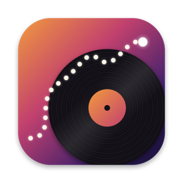

# Dérive

[](https://buymeacoffee.com/stephanepoulin)

Menu bar app for macOS. Press play and it picks a random album from the Bandcamp artists you
choose, and plays its tracks in order. Add as many artists or labels as you like.

## Features

- Random album, played track by track
- Radio mode: a new random album and track after each track
- Thumbs down: skip a track and never hear it again
- Media keys and Control Center's Now Playing
- Your own list of Bandcamp artists and labels, each one turned on or off
- Link your Bandcamp profile to play the artists and labels you follow, kept in sync
- Sign in to Bandcamp: your profile links by itself, and artists' messages show in Community
- Every artist that is turned on has the same chance, whatever the size of their catalog
- Album cover and current track, with a bar to see the time left and move in the track
- A player window that stays open, with a large cover, to keep on your desktop
- Play/pause, next track, and shuffle (new random album)
- Open the current album on Bandcamp
- The artist playing: photo, bio, upcoming shows and what fans wrote about the album
- The merch of the artist playing
- The artist's community page: new releases to play, listening parties, recent supporters

## Build

Requires macOS 13+ and Swift 5.9+.

```sh
./build.sh
open Derive.app
```

To install it in Applications, or to update the installed copy:

```sh
./build.sh install
```

This builds the app, quits the copy that is running, moves the new one to
`/Applications/Derive.app` and opens it. Only one copy is kept, so `derive://` links always reach
the installed app. Your artists and settings stay as they were.

To open Dérive when you log in, click **…** at the bottom right of the menu bar window and
choose **Open at Login**. It appears in System Settings › General › Login Items, where you can
also turn it off. **Quit Dérive** is in the same menu.

The app icon is drawn by `tools/make-icon.swift`. To change it, edit the script, then run
`swift tools/make-icon.swift icon.png`, turn `icon.png` into `Resources/AppIcon.icns` with
`iconutil`, and save a 256-pixel copy as `Resources/AppIcon.png` for this README.

## Artists

Click **Artists…**: the artist list opens next to the player. A narrow window grows to the right
to make room; a wide window (840 points or more) keeps its size, and the player gets narrower.
Click **Hide artists** to close it. The list starts empty: the first time you press play, the
list opens.

To add an artist or a label, click **+** at the top right of the list, paste the address of
their Bandcamp site, for example `artist.bandcamp.com` or any page of their site, then click
**Add**. Turn an artist off with its switch to skip them without removing them.

Click the play button next to an artist to hear a random album by that artist right away. This
turns radio mode off, so the album plays to the end, followed by other albums by that artist.

### Artists you follow on Bandcamp

The simplest way: click **Sign In to Bandcamp…**, in the empty list or in the **+** panel, and
sign in. Dérive links your profile by itself (see [Signing in to Bandcamp](#signing-in-to-bandcamp)).

Without signing in: click **+** and paste your Bandcamp profile, for example
`bandcamp.com/yourname`: the app sees it is a profile and links it. The profile must be public.

Either way, the artists and labels it follows appear under **Following on Bandcamp**.

The list updates at each launch, or when you choose **Refresh** in the **…** menu at the top
right: artists you follow on Bandcamp are added, and artists you unfollow are removed. Turning
one off here stays as you set it. **Unlink**, in the same menu, removes these artists; artists
added by hand stay. The menu also turns all of them on or off at once.

### Artists that can't be played

Some artists show in grey, with the reason in orange:

- **No audio on Bandcamp**: their releases have no tracks to listen to, even in a web browser.
- **Site can't be read by the app**: they use their own domain instead of `name.bandcamp.com`,
  and Bandcamp sends apps that aren't web browsers around in a loop there. They play in a web
  browser.
- **No releases on Bandcamp**: their page lists nothing.

The app finds these when it tries to play them, and skips them when picking at random for a
week. Then it tries them again, in case the artist changed something. To find them all at once,
choose **Check which artists can play** in the **…** menu; it reads each artist's site one at a
time, so it takes a few minutes.

### How an album is picked

To pick an album, the app first picks one of the artists that are turned on, each with the same
chance, then picks one of that artist's albums at random.

## Radio mode

By default, the app plays the random album from its first track to its last. When the album ends,
another random album by the same artist starts. To change artist, click shuffle. Click the radio
button, left of shuffle, to turn on radio mode: after each track, the app picks a new artist and
album at random, then plays a random track from it. The next track is picked while the current
one plays, so there is no wait between tracks. Click the button again to go back to albums.

## Thumbs down

Click the thumbs down to skip the current track and never play it again, in radio mode and in
albums. The app remembers these tracks by their Bandcamp ID. To hear one again, click
**Artists…**, open the **Thumbs down** tab and click the undo arrow next to it. Not sure it's the right track?
Click its play button to listen to it first.

## Panel tabs

The panel next to the player has two groups of tabs, each tab shown by an icon and a number.
Point at a tab to see its name.

On the left, the album playing. These tabs change with every album:

| Icon | Tab | Number |
| --- | --- | --- |
| (i) | The artist playing | Upcoming shows, when there are any |
| Speech bubbles | Community page of the artist playing | Posts listed, when there are any |
| Cart | Merch of the artist playing | Items still available |

Their numbers show without opening them, as soon as the album starts. When the artist changes
while the Merch or Community tab is open, and the new artist has nothing to show there, the
panel goes to the (i) tab.

On the right, your library. These tabs don't change with the music:

| Icon | Tab | Number |
| --- | --- | --- |
| People | Artists to pick from | Artists in the list |
| Thumbs down | Tracks given a thumbs down | Tracks |

## Artist playing

The **(i)** tab shows who plays the album playing, read from its Bandcamp page:

- the artist's photo, name and city, bio and links;
- upcoming shows, with the venue and the city; click one to open its page;
- the album: release date, tags, text and credits, and the comments fans left on it, with their
  favorite track.

For a label, the photo, bio and shows are the label's.

## Community

The **Community** tab shows the artist's Bandcamp community page (/community), for artists who
have one:

- the fans who bought something lately; click one to open their Bandcamp profile;
- the latest posts: new releases, listening parties and messages from the artist, with their date,
  likes and comments.

Click the cover of a new release to play it in Dérive, from its first track; radio mode turns off
so the whole release plays.

Bandcamp shows the text of the artist's messages only to followers signed in on Bandcamp.
Signed out, these messages are gathered in one line at the top of the posts: how many there are
and when the latest came, marked **New** when it is less than two weeks old. Click the arrow to
read them on Bandcamp.

### Signing in to Bandcamp

Signing in does two things: Dérive links your profile by itself, so it plays the artists you
follow, and it shows their messages in the Community tab. Click **Sign In to Bandcamp…** in the
empty artist list, in the + panel or in a "…" menu, or **Sign in to Bandcamp to read them** in
the Community tab. Bandcamp's own sign-in page opens in a window of the app; it closes by itself
once you're signed in.

- You type your password in Bandcamp's page: Dérive never sees it.
- When Bandcamp emails you to confirm a new device, don't click the link in the email: it would
  confirm your browser, not Dérive. Copy the link, paste it in the field at the bottom of the
  sign-in window and click **Open**.
- The session stays in the app's web data, and is sent only when reading community pages on
  bandcamp.com.
- When a profile is linked already, signing in doesn't change it.
- **Sign Out of Bandcamp** in a "…" menu removes the session from the app. The linked profile
  stays: unlink it in the "…" menu of the artist list.
- Signed in, the messages of artists you don't follow stay locked: follow them on Bandcamp to
  read them.

## Merch

The **Merch** tab of the artist list shows what the artist playing sells on Bandcamp: CDs,
records, tapes, clothes, prints. A slideshow at the top goes through every item still available,
one at a time, every 6 seconds; every item, sold out or not, is listed below it. Items of the album playing come first, with an
orange note; sold-out items are dimmed. Click an item to open it on Bandcamp.

For a label, this is the label's merch. Artists whose site can't be read by the app show no
merch either.

## Player window

The menu bar window closes when you click elsewhere. To keep the player on screen, click the pin
on the cover: the player opens in its own window. Resize it to make the cover bigger. Check
**On top** to keep it above other apps.

The window takes the main color of the cover, and the next cover fades in over the previous one.

Under the cover, a bar shows where the track is, with the time played on the left and the time
left on the right. Click or drag the bar to move in the track. Control Center's bar moves in the
track too.

The window keeps its place and size, and comes back at launch if it was open when you quit.

## Media keys and Control Center

The media keys of the keyboard control Dérive while it is the app playing:

| Key | Pressed | Held down |
| --- | --- | --- |
| Play/pause | Play or pause | — |
| Next | Next track | Moves fast forward in the track |
| Previous | Back to the start of the track (there is no previous track) | Moves fast back in the track |

Control Center's Now Playing shows the track, the artist and the cover.

On a Stream Deck, a media key held a little long counts as held down. For a next track every time,
use a `derive://next` link instead (see below).

## Remote control (Stream Deck, scripts)

The app handles `derive://` URLs while it is running:

| URL | Action |
| --- | --- |
| `derive://toggle` | Play / pause |
| `derive://play` | Play |
| `derive://pause` | Pause |
| `derive://next` | Next track |
| `derive://shuffle` | New random album |
| `derive://window` | Open the player window |
| `derive://artists` | Show or hide the artist list |
| `derive://radio` | Turn radio mode on |
| `derive://album` | Turn radio mode off: play whole albums |
| `derive://dislike` | Thumbs down on the current track |
| `derive://signin` | Open the Bandcamp sign-in window |
| `derive://artist?url=name.bandcamp.com` | Play a random album by that artist (radio off) |

From a terminal: `open -g derive://toggle` (`-g` keeps the app in the background).

The app was called Sonnov before: `sonnov://` links still work, and its settings are kept.

In Stream Deck, add a **Website** action (System category) with the URL, or an action that runs the
command above.

## Support

If Dérive saves you from picking the next album yourself, you can buy me a coffee.

<a href="https://buymeacoffee.com/stephanepoulin"></a>

Made by [Stéphane Poulin](https://www.stephanepoulin.com).
