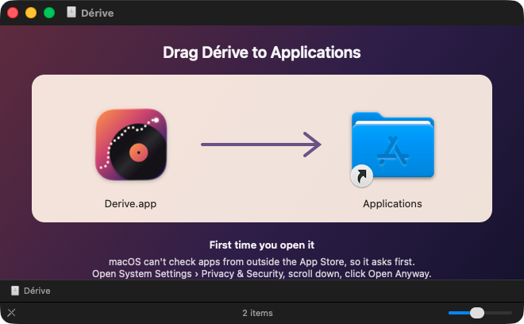
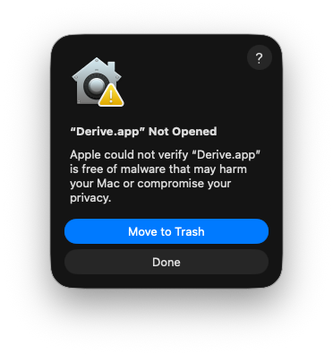
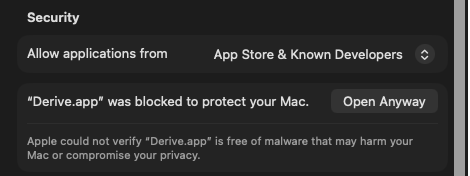

# RandAmp

[](https://buymeacoffee.com/stephanepoulin)

[](https://github.com/spoulin/randamp/releases/latest/download/RandAmp.dmg)

For macOS 13 or later, on Apple silicon and Intel Macs. See [Install](#install).

Menu bar app for macOS. Press play and it picks a random album from the Bandcamp artists you
choose, and plays its tracks in order. Add as many artists or labels as you like.

RandAmp was called Dérive until version 1.0.

## Features

- Random album, played track by track
- Radio mode: a new random album and track after each track
- Thumbs up: keep the tracks you like in a list, and play only them with Favorites
- Thumbs down: skip a track and never hear it again
- History of the tracks played, and an option to avoid repeats
- Media keys and Control Center's Now Playing
- Your own list of Bandcamp artists and labels, each one turned on or off
- Link your Bandcamp profile to play the artists and labels you follow, kept in sync
- Sign in to Bandcamp: your profile links by itself, artists' messages show in Community, and
  you can follow or unfollow artists from the app
- Every artist that is turned on has the same chance, whatever the size of their catalog
- Album cover and current track, with a bar to see the time left and move in the track
- A player window that stays open, with a large cover, to keep on your desktop
- Play/pause, next track, and the dice for another random album
- Open the current album on Bandcamp
- The artist playing: photo, bio, upcoming shows and what fans wrote about the album
- The merch of the artist playing
- The artist's community page: new releases to play, listening parties, recent supporters
- Shuffle in a fan's collection, from a supporter or a fan comment, and back to yours in a click
- Follow fans on Bandcamp, list them, shuffle in a random one's collection, or mix all their collections
- New releases: the latest albums added to Bandcamp, in the styles you choose

## Install

1. Click **Download** above to get `RandAmp.dmg`, then open it.
2. Drag RandAmp onto Applications.

   

3. Open RandAmp from Applications. The first time, macOS says it can't check it, because it
   doesn't come from the App Store or from a developer known to Apple. Click **Done**, not Move
   to Trash.

   

4. Open **System Settings › Privacy & Security**, scroll down to **Security**, and click
   **Open Anyway** next to the message about RandAmp. Confirm with your password or Touch ID,
   then click **Open Anyway** once more.

   

   Clicked Move to Trash by mistake? Open `RandAmp.dmg` again, drag RandAmp onto Applications,
   and start over at step 3.

That's needed once only: afterwards, RandAmp opens like any other app, at login too. RandAmp lives
in the menu bar: look for its icon at the top right of the screen. While its player window is
open, it's in the Dock too (see [Player window](#player-window)).

To update, choose **Check for Updates…** in a "…" menu: it opens the page of the latest version.
Download it and drag it onto Applications again, replacing the old one. Your artists and settings
stay as they were.

## Build

Requires macOS 13+ and Swift 5.9+.

```sh
./build.sh
open RandAmp.app
```

To install it in Applications, or to update the installed copy:

```sh
./build.sh install
```

This builds the app, quits the copy that is running, moves the new one to
`/Applications/RandAmp.app` and opens it. Only one copy is kept, so `randamp://` links always reach
the installed app. Your artists and settings stay as they were.

To open RandAmp when you log in, click **…** at the bottom right of the menu bar window and
choose **Open at Login**. It appears in System Settings › General › Login Items, where you can
also turn it off. **Quit RandAmp** is in the same menu.

### Releases

A version tag publishes a release: the Release workflow (`.github/workflows/release.yml`) builds
RandAmp for Apple silicon and Intel, makes `RandAmp.dmg` and attaches it to a GitHub release, which
the Download link above always points to.

```sh
git tag v1.0.0
git push origin v1.0.0
```

To make the disk image on your Mac: `pip3 install dmgbuild`, then `UNIVERSAL=1 ./build.sh` and
`tools/make-dmg.sh`. Its background is drawn by `tools/make-dmg-background.swift`, and its layout
is in `tools/dmg-settings.py`. The app is signed ad hoc, not notarized, hence the Open Anyway
step of the first launch.

The app icon is drawn by `tools/make-icon.swift`. To change it, edit the script, then run
`swift tools/make-icon.swift icon.png`, turn `icon.png` into `Resources/AppIcon.icns` with
`iconutil`, and save a 256-pixel copy as `Resources/AppIcon.png` for this README.

## Artists

Click the sidebar icon at the top right of the player window: the side panel opens next to the
player, with the artist list in its People tab (see [Panel tabs](#panel-tabs)). A narrow window
grows to the right to make room; a wide window (840 points or more) keeps its size, and the
player gets narrower. Click the icon again to close it. In the menu bar
player, **Panel** opens the window with its panel. The list starts empty: the first time you press
play, the panel opens.

To add an artist or a label, click **+** at the top right of the list, paste the address of
their Bandcamp site, for example `artist.bandcamp.com` or any page of their site, then click
**Add**. Turn an artist off with its switch to skip them without removing them.

Click the play button next to an artist to hear a random album by that artist right away. This
turns radio mode off, so the album plays to the end, followed by other albums by that artist.

### Artists you follow on Bandcamp

The simplest way: click **Sign In to Bandcamp…**, in the empty list or in the **+** panel, and
sign in. RandAmp links your profile by itself (see [Signing in to Bandcamp](#signing-in-to-bandcamp)).

Without signing in: click **+** and paste your Bandcamp profile, for example
`bandcamp.com/yourname`: the app sees it is a profile and links it. The profile must be public.

Either way, the artists and labels it follows appear under **Following on Bandcamp**.

The list updates at each launch, or when you choose **Refresh** in the **…** menu at the top
right: artists you follow on Bandcamp are added, and artists you unfollow are removed. Turning
one off here stays as you set it. **Unlink**, in the same menu, removes these artists; artists
added by hand stay. The menu also turns all of them on or off at once.

### Artists that can't be played

Some artists show in grey, with the reason in orange:

- **No audio on Bandcamp**: their releases have no tracks to listen to, even in a web browser.
- **Site can't be read by the app**: they use their own domain instead of `name.bandcamp.com`,
  and Bandcamp sends apps that aren't web browsers around in a loop there. They play in a web
  browser.
- **No releases on Bandcamp**: their page lists nothing.

The app finds these when it tries to play them: at random, it then picks another artist, and
skips them for a week before trying them again, in case the artist changed something. The play
button next to an artist finds out right away. Artists are looked at only when they come up, so
the app never sends Bandcamp a burst of requests.

When Bandcamp is busy or refuses requests, its error pages are not taken for an artist without
releases: nothing is marked. A request that gets no answer gives up after 15 seconds, and the
player says "Bandcamp isn't answering right now" instead of loading on and on.

### How an album is picked

To pick an album, the app first picks one of the artists that are turned on, each with the same
chance, then picks one of that artist's albums at random.

## Radio mode

By default, the app plays the random album from its first track to its last. When the album ends,
another random album by the same artist starts. To change artist, click the dice, left of play: another album at random. With radio or
Favorites on, the dice is greyed out: every track is already a new random pick, so next does it. Check **Radio**
at the bottom of the player window (or in the "…" menu of the menu bar player) to turn on radio
mode: after each track, the app picks a new artist and album at random, then plays a random track
from it. The next track is picked while the current one plays, so there is no wait between
tracks. Uncheck it to go back to albums.

## Thumbs up

Click the thumbs up, right of next, to keep the track playing in the **Liked** tab; it turns
blue. Click it again to remove it. The Liked tab lists these tracks with their cover: click a
cover or play to hear one again, or the undo arrow to remove it. A thumbs up removes a thumbs down, and the other way around.

### Favorites

Check **Favorites** at the bottom of the player window (or in the "…" menu of the menu bar
player) to play only your thumbs up: each track is picked at random among them, and radio doesn't
apply. With **Avoid repeats** on, the tracks heard lately come last. Playing an artist from the
list, or a new release from Community, turns Favorites off.

## Thumbs down

Click the thumbs down to skip the current track and never play it again, in radio mode and in
albums. The app remembers these tracks by their Bandcamp ID. To hear one again, open the side panel,
open the **Thumbs down** tab and click the undo arrow next to it. Not sure it's the right track?
Click its play button to listen to it first.

## Panel tabs

The panel next to the player has two groups of tabs, each tab shown by an icon and a number.
Point at a tab to see its name.

On the left, the album playing. These tabs change with every album:

| Icon | Tab | Number |
| --- | --- | --- |
| (i) | The artist playing | Upcoming shows, when there are any |
| Speech bubbles | Community page of the artist playing | Posts listed, when there are any |
| Cart | Merch of the artist playing | Items still available |

Their numbers show without opening them, as soon as the album starts.

At each new track, while one of these tabs is open, the panel goes through them by itself,
fading from one to the next: the (i) tab first, then Community after 30 seconds, then Merch 30
seconds later. On a short track, the next track starts the cycle again. A tab with nothing to
show is skipped: no community page or posts, or no merch still available. Click a tab to stop
this until the next track. While one of your library tabs is open, the panel stays on it.

On the right, your library, when **Library** is chosen at the top right of the panel (**New
Releases** shows the tabs of [New releases](#new-releases) instead). These tabs don't change with
the music:

| Icon | Tab | Number |
| --- | --- | --- |
| People | Artists to pick from | Artists in the list |
| Person in a circle | Fans you follow on Bandcamp | Fans |
| Thumbs up | Tracks given a thumbs up | Tracks |
| Thumbs down | Tracks given a thumbs down | Tracks |
| Clock | History of the tracks played | Tracks played today |

## Artist playing

The **(i)** tab shows who plays the album playing, read from its Bandcamp page:

- the artist's photo, name and city, bio and links;
- upcoming shows, with the venue and the city, and the ticket price when Songkick has it, with
  **Few left** or **Sold out**; click one to open its page. Prices are read only for the shows
  on screen;
- the album: release date, tags, text and credits, and the comments fans left on it, with their
  favorite track.

For a label, the photo, bio and shows are the label's.

### Follow and unfollow

Signed in to Bandcamp, the **Follow** button on the artist's photo (and at the top of the
Community tab) follows the artist or label on Bandcamp, as the button of their page does. They
join your followed artists in RandAmp right away. **Following** shows the ones you follow: point at
it and click to unfollow, which removes them from your followed artists. Signed out, the button
opens the sign-in window.

## Community

The **Community** tab shows the artist's Bandcamp community page (/community), for artists who
have one:

- the fans who bought something lately; click one to open their Bandcamp profile;
- the latest posts, always in full: new releases, listening parties and messages from the
  artist, with their date, likes and comments.

Click a supporter to shuffle in their collection (see [Someone else's collection](#someone-elses-collection));
right-click one to open their Bandcamp page.

Click the cover of a new release (a play glyph shows on hover) to play it in RandAmp, from its first track; radio mode turns off
so the whole release plays. Where the music comes from doesn't change: in New releases, the Fans
mix or someone's collection, the next album comes from there again.

Bandcamp shows the text of the artist's messages only to followers signed in on Bandcamp.
Signed out, these messages are gathered in one line at the top of the posts: how many there are
and when the latest came, marked **New** when it is less than two weeks old. Click the arrow to
read them on Bandcamp.

### Signing in to Bandcamp

Signing in does two things: RandAmp links your profile by itself, so it plays the artists you
follow, and it shows their messages in the Community tab. Click **Sign In to Bandcamp…** in the
empty artist list, in the + panel or in a "…" menu, or **Sign in to Bandcamp to read them** in
the Community tab. Bandcamp's own sign-in page opens in a window of the app; it closes by itself
once you're signed in.

- You type your password in Bandcamp's page: RandAmp never sees it.
- When Bandcamp emails you to confirm a new device, don't click the link in the email: it would
  confirm your browser, not RandAmp. Copy the link, paste it in the field at the bottom of the
  sign-in window and click **Open**.
- The session stays in the app's web data, and is sent only when reading community pages on
  bandcamp.com.
- When a profile is linked already, signing in doesn't change it.
- **Sign Out of Bandcamp** in a "…" menu removes the session from the app. The linked profile
  stays: unlink it in the "…" menu of the artist list.
- Signed in, the messages of artists you don't follow stay locked: follow them on Bandcamp to
  read them.

## History

The **History** tab lists the last 300 tracks played, the last one first, with their cover and
when they played. Click a cover or the play button to hear a track again, the arrow to open its album on Bandcamp, or
the thumbs down to never play it again. **Clear…** empties the list.

### Avoid repeats

Every artist has the same chance at each pick, so the few tracks of an artist with a small
catalog can come back often. Turn on **Avoid repeats**, at the top of the History tab, to skip:

- in radio mode, the tracks heard in the last 24 hours;
- in album mode, the albums heard in the last 24 hours;
- the artist just heard.

When nothing else can play, a track plays again rather than nothing. Off by default.

## Someone else's collection

Click a fan, among the recent supporters of the Community tab or the fan comments of the (i) tab,
to shuffle in their public Bandcamp collection instead of your artists. A line in the middle of
the player's footer shows their picture and name, **Follow**, and × to go back to your artists.
Click the name to open their Bandcamp page; point at it to see how much of the collection is
loaded (the rest loads in the background, unhurried). Right-click the line for the same actions,
when the window is too narrow to show it all.

Radio works there as with your artists: on, a random track of their collection after each track;
off, whole albums of their collection, one after the other. **Favorites** leaves their collection
to play your thumbs up.

Click × in that line to return to your artists: the music stops, and Play picks
from your artists again. Playing an artist from your list, or turning on Favorites, also brings
you back. A new release played from Community doesn't: it plays, then the collection goes on. The collection isn't kept: at launch, RandAmp is back with your artists.

## Fans you follow

Like artists, fans can be followed on Bandcamp, to find their collection again. Signed in to
Bandcamp (see [Signing in to Bandcamp](#signing-in-to-bandcamp)):

- in someone's collection, click **Follow** in the line at the bottom of the player;
- or right-click a recent supporter (Community tab) or a fan comment ((i) tab), and choose
  **Follow on Bandcamp**.

It's a real follow on Bandcamp: the fan shows on your Bandcamp profile too, and fans followed on
Bandcamp's site show in RandAmp. The **Fans** tab of the side panel lists them, read from your
profile at launch and when the tab opens (the arrow reads them again). Signed out, the list comes
from the profile linked in the Artists tab, and following needs a sign-in.

In the Fans tab:

- Click a fan's picture to shuffle in their collection, as above. A speaker marks the fan
  playing.
- **Random Fan** picks one of them at random and shuffles in their collection.
- **Fans mix** takes each album from the collection of a fan you follow, picked at random: one
  fan's album, then another fan's. A line in the middle of the player's footer shows whose
  collection the album comes from (click it to open the Fans tab); its × turns the mix off and
  stops the music. Radio works in the mix too. Fans mix is also in the "…"
  menu, and stays on from one launch to the next. Favorites, someone's collection, or playing an
  artist turns it off; a new release played from Community plays, then the mix goes on.
- Right-click a fan to open their Bandcamp page or unfollow them.

## New releases

**New releases** plays the latest albums added to Bandcamp, like the "new arrivals" of
[Bandcamp Discover](https://bandcamp.com/discover), in the styles you choose.

At the top right of the side panel, **Library | New Releases** chooses what plays and what the
right tabs show. Switching from one to the other stops the music; Play then picks from the
other side, and nothing starts by itself. **New Releases** shows two tabs: **Styles** (a tag, with the number of styles chosen) and **Latest** (sparkles, with the
number of releases listed). **Library** goes back to your artists and their tabs (artists, fans,
thumbs up and down, history). The tabs of the album playing stay on the left. New Releases is
also in a "…" menu, the Playback menu and the Dock menu.

- Each album is picked at random among the 100 latest added in those styles, skipping what you
  heard lately. Radio works too: a random track of a new release after each track.
- **Styles**: type any Bandcamp tag in the field (shoegaze, dub techno…), or click one of the
  suggestions: **From the album playing** (its tags, as on its Bandcamp page: hear something you
  like, add its style), **Recent** (the last styles you added), and Bandcamp's main **Genres**. Places are tags too: montreal, berlin. Each style added narrows the list: releases
  with all of them (ambient + drone, ambient + montreal). RandAmp checks with Bandcamp before
  adding a style, and says how many releases have them. No style: everything new on Bandcamp.
- **Latest** lists those releases, newest added first, with the release date the artist
  gave (an old album put on Bandcamp this week shows its year). Click a cover to play that
  release from its first track; another new release follows.
- A line in the middle of the player's footer shows the styles while the mode is on: click it to
  open Styles, or its × to go back to your artists, like **Library**. Favorites, Fans
  mix, someone's collection, or playing an artist turns it off too. A release played from
  Community or Latest doesn't: it plays to the end, then another new release follows.

The list comes from the endpoint Bandcamp's Discover page loads its results from. It isn't a
documented API: Bandcamp may change it, and the mode would then stop working.

## Merch

The **Merch** tab of the side panel shows what the artist playing sells on Bandcamp: CDs,
records, tapes, clothes, prints. A slideshow at the top goes through every item still available,
one at a time, every 6 seconds; every item, sold out or not, is listed below it. Items of the album playing come first, with an
orange note; sold-out items are dimmed. Click an item to open it on Bandcamp.

For a label, this is the label's merch. Artists whose site can't be read by the app show no
merch either.

## Player window

The menu bar window closes when you click elsewhere. To keep the player on screen, click the pin
on the cover: the player opens in its own window. Resize it to make the cover bigger. Check
**On top** to keep it above other apps.

The window takes the main color of the cover, and the next cover fades in over the previous one.

Under the cover, a bar shows where the track is, with the time played on the left and the time
left on the right. Click or drag the bar to move in the track. Control Center's bar moves in the
track too.

The window keeps its place and size, and comes back at launch if it was open when you quit.

### In the Dock while the window is open

While the player window is open (or minimized), RandAmp is a regular app: its icon is in the Dock
and in ⌘-Tab, and the menus at the top of the screen are its own. Close the window and the icon
leaves the Dock; the music goes on, and the menu bar icon stays.

- Click the Dock icon to bring the window back.
- Right-click it for the controls: Play/Pause, Next Track, New Random Album, Thumbs Up, Thumbs
  Down, Radio, Favorites, Fans Mix, New Releases.
- The **RandAmp** menu has Check for Updates. The **Playback** menu has the same controls, with
  shortcuts: ⌥⌘P play/pause, ⌘→ next track, ⌘R new random album, ⌘↑ thumbs up, ⌘↓ thumbs
  down, ⌥⌘S side panel.

To keep RandAmp in the menu bar only, turn off **Show in Dock While Open** in a "…" menu.

A short message at the bottom of the player says what an action just did: favorites or radio on
or off, on top or not, thumbs up or down. It fades out after a few seconds.

## Media keys and Control Center

The media keys of the keyboard control RandAmp while it is the app playing:

| Key | Pressed | Held down |
| --- | --- | --- |
| Play/pause | Play or pause | — |
| Next | Next track | Moves fast forward in the track |
| Previous | Back to the start of the track (there is no previous track) | Moves fast back in the track |

Control Center's Now Playing shows the track, the artist and the cover.

On a Stream Deck, a media key held a little long counts as held down. For a next track every time,
use a `randamp://next` link instead (see below).

## Remote control (Stream Deck, scripts)

The app handles `randamp://` URLs while it is running:

| URL | Action |
| --- | --- |
| `randamp://toggle` | Play / pause |
| `randamp://play` | Play |
| `randamp://pause` | Pause |
| `randamp://next` | Next track |
| `randamp://shuffle` | New random album |
| `randamp://window` | Open the player window |
| `randamp://panel` | Show or hide the side panel (`randamp://artists` works too) |
| `randamp://radio` | Turn radio mode on |
| `randamp://album` | Turn radio mode off: play whole albums |
| `randamp://dislike` | Thumbs down on the current track |
| `randamp://like` | Thumbs up on the current track, or remove it |
| `randamp://favorites` | Turn Favorites on or off |
| `randamp://fansmix` | Turn Fans mix on or off |
| `randamp://randomfan` | Shuffle in the collection of a fan you follow, picked at random |
| `randamp://newreleases` | Turn New releases on or off |
| `randamp://collection?user=name` | Shuffle in a fan's collection; `randamp://collection` alone goes back to yours |
| `randamp://signin` | Open the Bandcamp sign-in window |
| `randamp://artist?url=name.bandcamp.com` | Play a random album by that artist (radio off) |

From a terminal: `open -g randamp://toggle` (`-g` keeps the app in the background).

The app was called Dérive, and Sonnov before that: `derive://` and `sonnov://` links still work, and
its settings and Bandcamp session are kept.

In Stream Deck, add a **Website** action (System category) with the URL, or an action that runs the
command above.

## Support

If RandAmp saves you from picking the next album yourself, you can buy me a coffee.

<a href="https://buymeacoffee.com/stephanepoulin"></a>

Made by [Stéphane Poulin](https://www.stephanepoulin.com).
